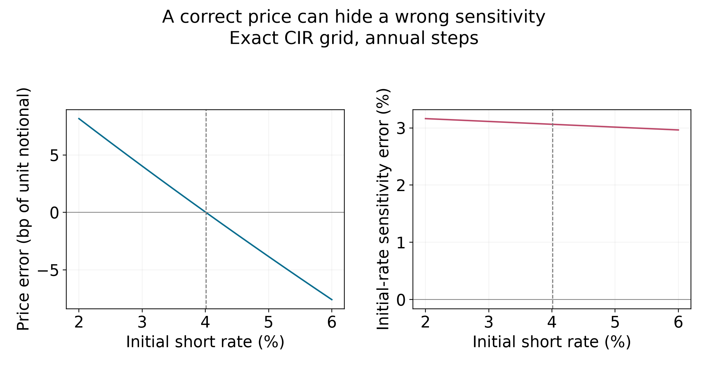
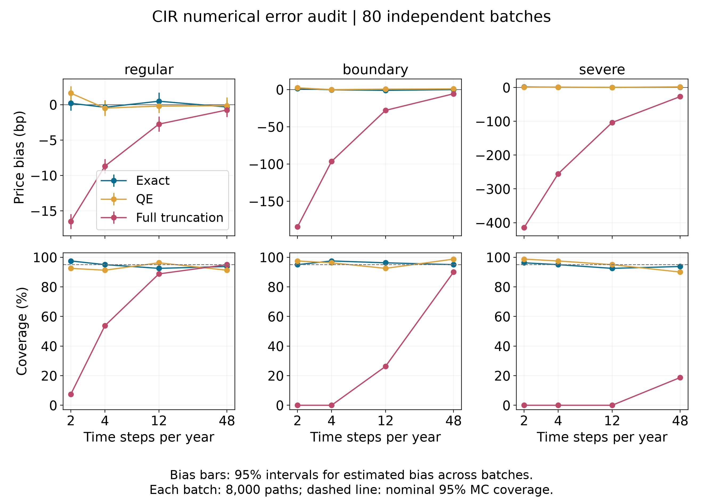

# Numerical Error in CIR Discount Prices and Initial-Rate Sensitivities

## Abstract

Exact simulation of a diffusion at grid points does not make a discretized path integral exact. Likewise, a Monte Carlo confidence interval need not cover the continuous-time price. This report uses the Cox–Ingersoll–Ross (CIR) model to separate integration bias, state-discretization bias, and sampling error. Across three synthetic parameter regimes, three simulation schemes, and four grids, 2,880 independent batches of 8,000 paths expose substantial full-truncation Euler bias near the attainable boundary. An affine cancellation example also matches a price exactly while overstating its initial-rate sensitivity by 3.062%. This is a reproducible validation study using established methods; neither the affine recursion nor the coverage-distortion mechanism is claimed as new.

## 1. Model, targets, and prior work

Under the risk-neutral measure, consider

$$
dr_t=\kappa(\theta-r_t)\thinspace{}dt+\sigma\sqrt{r_t}\thinspace{}dW_t,
\qquad \kappa,\theta,\sigma>0,\quad r_0\geq0.
$$

The targets are a unit-notional discount bond and its initial-short-rate sensitivity magnitude:

$$
P(T,r_0)=\mathbb E\left[\exp\left(-\int_0^T r_s\thinspace{}ds\right)\right],
\qquad G=-\partial_{r_0}P.
$$

Here $G$ is not a parallel-yield-curve DV01. The classic CIR solution [1] has $P=Ae^{-Br_0}$. For completeness, substituting this form into the pricing equation gives

$$
B'=1-\kappa B-\tfrac12\sigma^2B^2,
\qquad (\log A)'=-\kappa\theta B,
\qquad B(0)=0,\quad A(0)=1.
$$

Solving these equations, with $\gamma=\sqrt{\kappa^2+2\sigma^2}$, yields

$$
B=\frac{2(e^{\gamma T}-1)}{(\gamma+\kappa)(e^{\gamma T}-1)+2\gamma},
\qquad
A=\left[\frac{2\gamma e^{(\kappa+\gamma)T/2}}
{(\gamma+\kappa)(e^{\gamma T}-1)+2\gamma}\right]^{2\kappa\theta/\sigma^2}.
$$

Thus $G=BP$, providing deterministic reference values for both outputs.

Peng and Kou [2, Section 2.5.2, Lemma 2] already derived the affine transform of the trapezoidal CIR integral. Full truncation [3] and quadratic-exponential (QE) simulation [4] are established schemes. Discretization-induced confidence-interval distortion was studied by Detemple, Garcia, and Rindisbacher [5]. Recent work includes high-order log-Heston approximations [6] and weak convergence analysis for an implicit CIR scheme under the Feller condition [7]. The present benchmark implements classical baselines, not those high-order methods.

## 2. Exact grid reference and error decomposition

For $h=T/N$, write $r_j=r_{jh}$ and

$$
I_h=h\left(\frac{r_0}{2}+\sum_{j=1}^{N-1}r_j+\frac{r_N}{2}\right),
\qquad P_h=\mathbb E[e^{-I_h}],
$$

where the states follow exact CIR transitions. Let $P_h^S$ instead denote the expectation under approximate scheme $S$. Then an estimator from $n$ independent paths satisfies the identity

$$
\widehat P_{h,n}^S-P
=\underbrace{P_h-P}_{\text{integration bias}}
+\underbrace{P_h^S-P_h}_{\text{state-scheme bias}}
+\underbrace{\widehat P_{h,n}^S-P_h^S}_{\text{sampling error}}.
$$

Only the last term is measured by the usual Monte Carlo standard error. Estimated state-scheme bias also retains sampling uncertainty.

To compute $P_h$ without Monte Carlo, define

$$
q=e^{-\kappa h},\qquad c=\frac{\sigma^2(1-q)}{4\kappa},
\qquad d=\frac{4\kappa\theta}{\sigma^2}.
$$

The exact transition and its Laplace transform are

$$
r_{t+h}\mid r_t=x\sim c\chi_d^{\prime 2}(qx/c),
\qquad
\mathbb E[e^{-ur_{t+h}}\mid r_t=x]
=(1+2cu)^{-d/2}\exp\left(-\frac{qux}{1+2cu}\right).
$$

**Recursion and proof.** Let $F_j(x)$ be the expected discount factor over $j$ grid intervals starting at $x$. Start with $F_0(x)=1=\exp(-a_0-b_0x)$. The Markov property gives

$$
F_{j+1}(x)=e^{-hx/2}\mathbb E\left[e^{-hr_h/2}F_j(r_h)\mid r_0=x\right].
$$

Substitute $F_j(y)=\exp(-a_j-b_jy)$ and the conditional transform. With $u_j=b_j+h/2$, this becomes $\exp(-a_{j+1}-b_{j+1}x)$, where

$$
a_{j+1}=a_j+\frac d2\log(1+2cu_j),
\qquad b_{j+1}=\frac h2+\frac{qu_j}{1+2cu_j}.
$$

Induction proves $P_h=\exp(-a_N-b_Nr_0)$ and direct differentiation gives $G_h=b_NP_h$. Replacing each $h/2$ discount weight by $h$ computes $\mathbb E[e^{-2I_h}]$, hence the exact grid-path variance. These references have floating-point error but no sampling error. Exact state transitions still leave the integration bias $P_h-P$.

## 3. Matching a price while missing its sensitivity

Write $A_h=e^{-a_N}$ and $B_h=b_N$. If $B_h\ne B$ and

$$
r^*=\frac{\log A_h-\log A}{B_h-B}\geq0,
$$

then $\log(P_h/P)=\log A_h-\log A-(B_h-B)r^*=0$. Consequently,

$$
P_h(r^*)=P(r^*),\qquad
\frac{G_h(r^*)}{G(r^*)}-1=\frac{B_h}{B}-1.
$$

For $(\kappa,\theta,\sigma,T)=(0.6,0.04,0.1,5)$ and annual steps, $r^*=0.0400853469$. Both prices equal $0.8198175474$ to the reported precision. The grid and continuous sensitivities are respectively $1.3246467181$ and $1.2852865306$, a **3.06237%** relative error. This constructed example demonstrates why one matching price does not validate its local derivative; it does not estimate the frequency of such failures in market calibration.



## 4. Simulation design

All three schemes use trapezoidal discounting. **Exact** samples the noncentral chi-square transition. **Full-truncation Euler** retains a potentially negative auxiliary state:

$$
X_{j+1}=X_j+\kappa(\theta-X_j^+)h+\sigma\sqrt{X_j^+h}\thinspace{}Z_j,
\qquad r_j^{\mathrm{used}}=X_j^+,
$$

with independent standard-normal $Z_j$. Its positive projection is used in the integral; the raw state is retained for the next update.

**QE** matches the exact conditional mean and variance,

$$
m=\theta+(x-\theta)q,\quad
v=\frac{x\sigma^2q(1-q)}\kappa+
\frac{\theta\sigma^2(1-q)^2}{2\kappa},\quad \psi=v/m^2.
$$

For $\psi\leq1.5$, set $b^2=2/\psi-1+\sqrt{(2/\psi)(2/\psi-1)}$, $a=m/(1+b^2)$, and draw $Y=a(b+Z)^2$ with $b\geq0$. Otherwise set $p=(\psi-1)/(\psi+1)$ and $\beta=(1-p)/m$; for uniform $U$, draw $Y=0$ if $U\leq p$ and $Y=\beta^{-1}\log((1-p)/(1-U))$ otherwise. Matching two moments does not ensure an unbiased path functional.

The horizon is five years. Parameters are manually chosen, not market-calibrated:

| Regime | $\kappa$ | $\theta$ | $\sigma$ | $r_0$ | $2\kappa\theta/\sigma^2$ |
|---|---:|---:|---:|---:|---:|
| regular | 0.6 | 0.04 | 0.10 | 0.030 | 4.80000 |
| boundary | 0.4 | 0.02 | 0.35 | 0.005 | 0.13061 |
| severe | 0.3 | 0.01 | 0.60 | 0.001 | 0.01667 |

Each scheme/regime uses 2, 4, 12, and 48 steps per year, with **80 independent batches of 8,000 paths per combination**: 2,880 batches and 23.04 million paths. Seeds are assigned from base 20261011. Each batch reports its mean plus or minus 1.96 estimated standard errors; coverage is evaluated against continuous-time $P$. Schemes do not share common random numbers, and this is not an equal-runtime comparison.

## 5. Results and interpretation

Bias below is in units of $10^{-4}$ of principal, not yield basis points. Parentheses contain the Monte Carlo standard error of the average bias across 80 batches.

| Regime | Steps/year | Scheme | Bias, bp (MCSE) | Coverage |
|---|---:|---|---:|---:|
| boundary | 2 | Exact | +1.397 (1.114) | 76/80 |
| boundary | 2 | QE | +2.386 (1.095) | 78/80 |
| boundary | 2 | Full truncation | −184.408 (1.324) | 0/80 |
| boundary | 12 | Full truncation | −27.980 (1.205) | 21/80 |
| severe | 48 | Full truncation | −26.888 (1.196) | 15/80 |
| severe | 48 | QE | +1.928 (0.995) | 72/80 |
| regular | 48 | Full truncation | −0.752 (0.505) | 76/80 |

For boundary/2, the exact-grid integration bias is only +1.219 bp, whereas full truncation's average interval half-width is 23.546 bp. State discretization dominates. Under regular/48, the experiment provides no comparable evidence of a material full-truncation problem. Negative auxiliary-state frequency is not a monotone error proxy: in the severe regime it rises with refinement while price bias falls.



The bias bars summarize uncertainty across batches. The dashed coverage reference is 95%. With 80 repetitions, a true 95% coverage rate has sampling standard error approximately 2.44 percentage points; small coverage differences do not establish a ranking. The Wilson 95% upper limit for 0/80 is about 4.58%, not zero.

At fixed $h$, if $P_h^S\ne P$, the law of large numbers makes the estimated mean converge to $P_h^S$ while the interval half-width vanishes. Since simulated discount factors are bounded, these limits imply that coverage of $P$ tends to zero. More paths cannot remove discretization bias, consistent with [5].

Implementation checks compare fine grids with analytic prices, analytic sensitivities with central differences, and sampling variances with the discrete second moment. An additional 20 batches of 10,000 exact paths give a mean-check $z$ statistic of −0.716 and variance ratio 1.00397. QE conditional moments are also checked at three initial states. These checks validate implementations, not new convergence theorems.

## 6. Scope and reproducibility

This study holds parameters fixed, uses synthetic scenarios, and studies a tractable bond payoff. The sensitivity example is analytic; the simulation table does not evaluate Monte Carlo Greek estimators. Conclusions do not establish performance for calibrated curves, Heston path-dependent products, or rough volatility. Coarse/fine differences are not certified error bounds without additional analysis. Joint price/sensitivity stopping rules would also need to account for repeated inspection and parameter uncertainty.

Reproduce the main run from the repository root:

```bash
python study.py --reps 80 --paths 8000 --output-dir results/full
```

Use a fresh output directory; nonempty destinations are rejected. The accompanying CSV and JSON files retain batch estimates, standard errors, coverage indicators, deterministic references, and cancellation examples. Changing parameters or sample sizes requires regenerating outputs before quoting this report's numbers.

## References

1. Cox, J. C., Ingersoll, J. E., and Ross, S. A. (1985). [A Theory of the Term Structure of Interest Rates](https://doi.org/10.2307/1911242). *Econometrica*, 53(2), 385–407.
2. Peng, X., and Kou, S. S. G. (2008). [Connecting the Top-Down to the Bottom-Up: Pricing CDO under a Conditional Survival (CS) Model](https://english.phbs.pku.edu.cn/uploadfile/2019/0920/20190920023124792.pdf). *Winter Simulation Conference*, 578–586. Section 2.5.2, Lemma 2.
3. Lord, R., Koekkoek, R., and van Dijk, D. (2010). [A Comparison of Biased Simulation Schemes for Stochastic Volatility Models](https://papers.tinbergen.nl/06046.pdf). *Quantitative Finance*, 10(2), 177–194; linked working-paper version.
4. Andersen, L. (2008). [Simple and Efficient Simulation of the Heston Stochastic Volatility Model](https://www.maths.univ-evry.fr/pages_perso/crepey/Finance/andersen%20vol%20sto.pdf). *Journal of Computational Finance*, 11(3), 1–42. Linked manuscript: *Efficient Simulation of the Heston Stochastic Volatility Model*, December 12, 2006.
5. Detemple, J., Garcia, R., and Rindisbacher, M. (2003). [Asymptotic Properties of Monte Carlo Estimators of Diffusion Processes](https://cirano.qc.ca/files/publications/2003s-11.pdf). CIRANO 2003s-11.
6. Alfonsi, A., and Lombardo, E. (2025). [High Order Approximations and Simulation Schemes for the Log-Heston Process](https://arxiv.org/abs/2407.17151). *SIAM Journal on Financial Mathematics*, 16(2), 516–544; initial preprint 2024.
7. Pavlis, A., and Çetin, U. (2026). [Weak Convergence Rate for the Cox–Ingersoll–Ross Process](https://arxiv.org/abs/2607.07552). Preprint. Literature checked October 11, 2026.
